

  

 

Diseño, construyo y pongo en producción **aplicaciones con inteligencia artificial** para empresas y pymes: generación de imagen y vídeo, avatares con voz, reservas, cartas digitales y automatización.

Todo lo que ves aquí **está en vivo**. Pulsa cualquier tarjeta para abrirlo.

 

  

  

<table>
  <tr>
    <td width="50%"><a href="https://www.aihumanslab.com"></a></td>
    <td width="50%"><a href="https://www.click2model.es"></a></td>
  </tr>
  <tr>
    <td width="50%"><a href="https://www.innovagastro.es"></a></td>
    <td width="50%"><a href="https://lumiere.innovapymes.ai"></a></td>
  </tr>
  <tr>
    <td width="50%"><a href="https://companions.innovapymes.ai"></a></td>
    <td width="50%"><a href="https://ofertaalavista.com"></a></td>
  </tr>
</table>

| App | Qué hace | Por dentro |
|---|---|---|
| **[AI Humans Lab](https://www.aihumanslab.com)** | Avatares digitales, vídeos virales y contenido UGC para redes | React · Supabase autohospedado · fal.ai · Stripe |
| **[Click2Model](https://www.click2model.es)** | La tienda sube una prenda y obtiene fotos y Reels con modelos de IA | React · Supabase autohospedado · fal.ai |
| **[InnovaGastro](https://www.innovagastro.es)** | Carta digital por QR, asistente con IA y reservas con mesas y aforo | React · Supabase · Gemini |
| **[Lumière](https://lumiere.innovapymes.ai)** | Reservas, bonos, suscripciones y cambio de look con IA para salones | React · Supabase · Stripe · Gemini |
| **[Companions](https://companions.innovapymes.ai)** | Avatares 3D que te escuchan y responden hablando, con gestos | Next.js · three.js · VRM · OpenAI Realtime |
| **[Oferta a la Vista](https://ofertaalavista.com)** | Comparador de ofertas con miles de productos verificados | TypeScript · afiliación |

  

<table>
  <tr>
    <td width="33%"><a href="https://dania360.com"></a></td>
    <td width="33%"><a href="https://dania-tunel.vercel.app"></a></td>
    <td width="33%"><a href="https://nordauto-markina.vercel.app"></a></td>
  </tr>
  <tr>
    <td width="33%"><a href="https://ambinature-andorra.vercel.app"></a></td>
    <td width="33%"><a href="https://web-demo-glousie-murcia.vercel.app"></a></td>
    <td width="33%"><a href="https://web-demo-maria-candida-aleman-hita.vercel.app"></a></td>
  </tr>
  <tr>
    <td width="33%"><a href="https://estefania-plaza-demo.vercel.app"></a></td>
    <td width="33%"><a href="https://maria-martin-demo.vercel.app"></a></td>
    <td width="33%"><a href="https://barbara-marrero-psicologia.vercel.app"></a></td>
  </tr>
</table>

Cada web lleva una pieza interactiva pensada para ese negocio: un parte de daños sobre el plano del coche, un plano para dibujar la reforma, un test de piel, una calculadora de láser o un túnel 3D.

  

Los modelos que generan las imágenes y los vídeos de mis apps, empaquetados para ejecutarse bajo demanda en GPU.

| Repositorio | Para qué sirve |
|---|---|
| [comfy-runpod-worker](https://github.com/Jose-Bustos-AI/comfy-runpod-worker) | Flujos de ComfyUI como servicio bajo demanda en RunPod |
| [t2i-flux-lora](https://github.com/Jose-Bustos-AI/t2i-flux-lora) | Imagen a partir de texto con FLUX y LoRA entrenadas |
| [wan2.2_lora](https://github.com/Jose-Bustos-AI/wan2.2_lora) | Vídeo con WAN 2.2 y LoRA |
| [Infinitetalk_Runpod_hub](https://github.com/Jose-Bustos-AI/Infinitetalk_Runpod_hub) | Avatares que hablan con sincronía labial (adaptación) |
| [Reels_Virales_Runpod_hub](https://github.com/Jose-Bustos-AI/Reels_Virales_Runpod_hub) | Reels a partir de un vídeo de referencia (adaptación) |
| [generate_video](https://github.com/Jose-Bustos-AI/generate_video) | Generación de vídeo en GPU (adaptación) |

  

  

 

- **Producto:** React, TypeScript, Next.js y Tailwind, con three.js cuando hace falta 3D.
- **Backend:** Supabase autohospedado en servidor propio (PostgreSQL, funciones, almacenamiento), Docker y Caddy.
- **IA:** fal.ai, OpenAI (incluida la voz en tiempo real), Gemini, ElevenLabs, ComfyUI y modelos propios en RunPod.
- **Negocio:** Stripe, automatización con n8n y agentes.

  

  <picture>
    <source media="(prefers-color-scheme: dark)" srcset="https://raw.githubusercontent.com/Jose-Bustos-AI/Jose-Bustos-AI/output/serpiente-oscura.svg">
    
  </picture>
    
  

  

  

